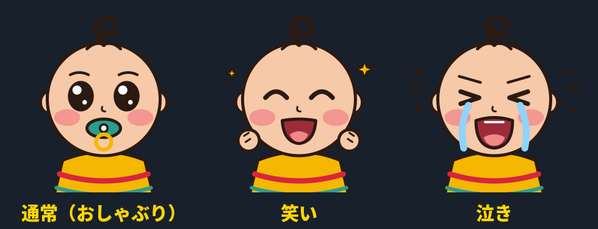

# ベベ（オラポン君とドローレスの赤ちゃん） キャラクター設定シート

| 項目 | 内容 |
|---|---|
| 名前 | ベベ（スペイン語の *bebé*＝赤ちゃん。名前そのものが単語の勉強になる） |
| 見た目 | 大きな丸い顔、うるうるの大きな目、まっかなほっぺ。ママ（ドローレス）ゆずりの黒髪の大きなくるりん1本、パパ（オラポン君）ゆずりのポンチョ柄のよだれかけ |
| 持ち物 | おしゃぶり（スペイン語で *chupete*） |
| 性格（案） | まだしゃべれないが、スペイン語の正解がわかる（？）。パパが正解すると笑い、間違えると泣く。意地悪なママも、ベベにだけは甘い |

## 表情（expressions/）
| ファイル | 表情 | 使う場面の例 |
|---|---|---|
| 01_normal | 通常（おしゃぶりをくわえて、うるうるの目） | ふだん |
| 02_warai | 笑い（目を細めて大きく口を開け、小さなこぶし、キラキラ） | パパが正解したとき |
| 03_naki | 泣き（目をぎゅっとつぶって大泣き、涙） | パパが間違えたとき、ママが怒ったとき |

## 素材の決まり
- 他のキャラクターと同じ：SVG・背景透過・viewBox "30 28 240 236"・書き出し 960x944・線 #2A1A12・太さ4
- 色：肌 #F6C9A8 / ほっぺ #F2878A / 髪 #2A1A12 / よだれかけ #F5B700（しま #D7263D・#2A9D8F）/ おしゃぶり #2A9D8F・#F5B700
- 口パク用の素材はまだない
- まだ清書前のラフ
