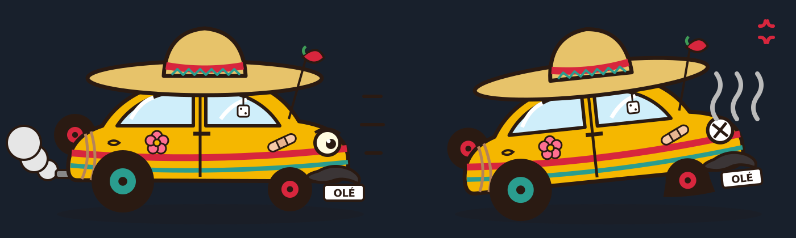

# オラポン一家の車（コミカル版）

| ファイル | 中身 |
|---|---|
| `01_hashiru.svg` | 走っている（排気ガスのけむり、スピードの線、ヘッドライトの目がキョロッ） |
| `02_enko.svg` | 故障（前輪がパンク、湯気、目が×、怒りマーク、車体が傾く） |
| `make_car.py` | 車を作るプログラム（色や形を変えるときはここを直して `python3 characters/car/make_car.py`） |

## デザイン
- ずんぐりした丸い車。オラポン君のポンチョと同じ黄色に、赤と青緑のしま
- 屋根に大きなソンブレロをかぶっている
- 前に顔：ヘッドライトが目、バンパーがオラポン君っぽいヒゲ
- タイヤはふぞろい（後ろが大きく前が小さい、ホイールの色も違う）
- へこみ、ばんそうこう、ロープでしばったトランク、背中の予備タイヤ
- アンテナのてっぺんにトウガラシ、ルームミラーにサイコロ、ドアに花のステッカー
- ナンバープレートは「OLÉ」
- 実在の車種はまねていないオリジナル。キャラクターと同じ絵柄
- まだ清書前のラフ
