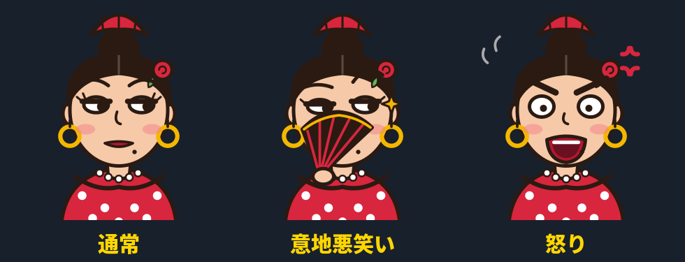

# ドローレス（オラポン君の奥さん） キャラクター設定シート

| 項目 | 内容 |
|---|---|
| 名前 | ドローレス（スペイン語の *dolores*＝痛み・悲しみ。オラポン君の悩みのたね、という意味をこめて） |
| 見た目 | フラメンコ風。黒髪のおだんご、赤い髪飾り（ペイネタ）とバラ、金の輪っかイヤリング、真珠のネックレス、赤い水玉のドレス、口元のほくろ、扇子 |
| 性格（案） | 意地悪。オラポン君のスペイン語の間違いを、扇子で口元を隠して笑う。たまに怒鳴る。でもスペイン語は完璧 |
| 口ぐせ（案） | 「オホホ」。オラポン君の間違いに「¡Qué vergüenza!（なんて恥ずかしい！）」 |

## 表情（expressions/）
| ファイル | 表情 | 使う場面の例 |
|---|---|---|
| 01_normal | 通常（ジト目で横目、冷たい口元） | ふだん、オラポン君を見下ろす |
| 02_ijiwaru | 意地悪笑い（扇子で口元を隠し、片方の眉を上げて横目） | 直訳の間違い（不正解）のとき |
| 03_okori | 怒り（眉をつり上げてどなる、怒りマーク） | オラポン君が調子に乗ったとき |

## 素材の決まり
- オラポン君と同じ：SVG・背景透過・viewBox "30 28 240 236"・書き出し 960x944・線 #2A1A12・太さ4
- 色：肌 #F6C9A8 / 髪 #2A1A12 / ドレス・髪飾り #D7263D / 口紅 #B5172F / イヤリング #F5B700
- 口パク用の素材はまだない（しゃべらせる場合は作る）
- まだ清書前のラフ
