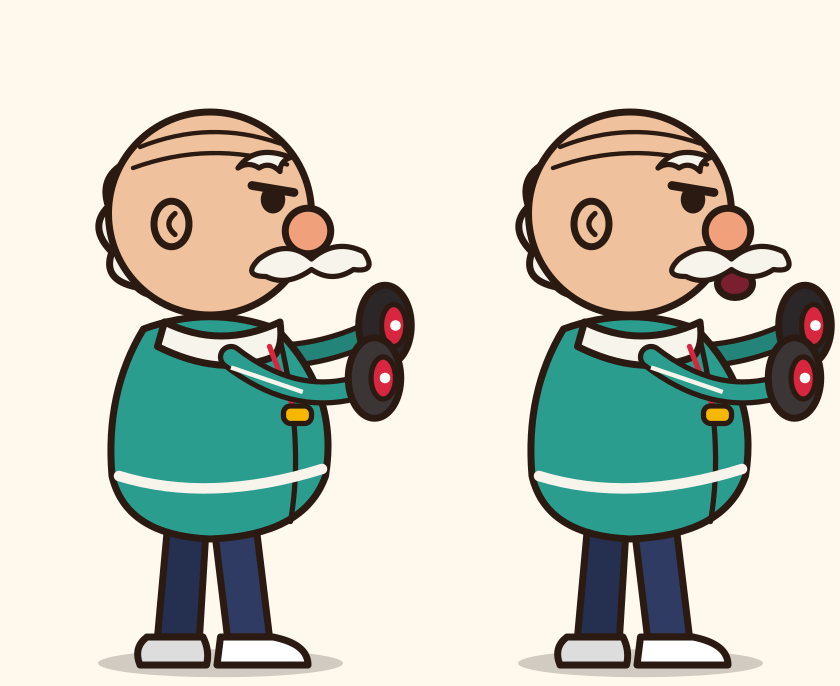

# マノロ会長（ボクシングジムの会長） キャラクター設定シート

| 項目 | 内容 |
|---|---|
| 名前 | マノロ（Manolo。スペインでよくある名前 Manuel の愛称） |
| 何者か | 町の小さなボクシングジム「Gimnasio Manolo」の会長。オラポン君のトレーナー |
| 年齢 | 70代。若いころは町の英雄ボクサーだった（らしい） |
| 見た目 | ずんぐりした体、はげ頭に後ろだけふわふわの白髪、白いもじゃもじゃのまゆ、大きな丸い鼻、白いカイゼルひげ。青緑のジャージ、首にタオルと笛、紺のズボン、白いスニーカー。黒いミット（真ん中が赤い的） |
| 性格 | 口うるさくて、きびしい。でも誰よりもオラポン君を信じている。ほめるのは下手 |
| 口ぐせ | 「¡Uno, dos!（ワン、ツー）」「¡Más fuerte!（もっと強く）」「¡Guardia!（ガード！）」。ほめるときは短く「¡Muy bien!」 |
| 役割 | トレーニングの指示がすべてスペイン語なので、ジムの場面は短い命令形・数字・ほめ言葉を覚える場になる |
| お決まり | オラポン君が調子に乗ってガードを下げると、ミットで頭をポコッ |

## 素材
- `side.svg`（ふつう）、`side_shout.svg`（口を開けてどなる）。右向き。画面では左右反転してオラポン君と向き合わせる
- 作り直すときは `python3 characters/make_boxing.py --preview`（ミットの位置・打たれてのけぞる・ひじの曲がりは関数の引数で動かせる）
- 縮尺・線（#2A1A12、太さ4）はオラポン君と同じ
- 色：肌 #EFC19C / ジャージ #2A9D8F / ズボン #2F3B63 / ひげ・髪・タオル #F7F4EC / ミット #3B3536・#D7263D
- ジムの背景：`../scenes/gym.png`（`make_gym.py`）
