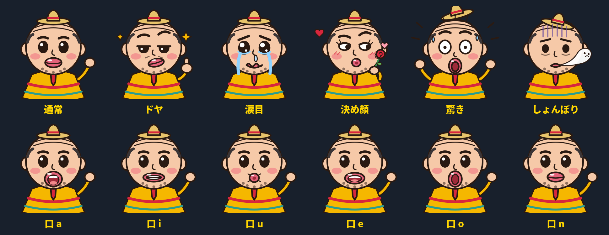
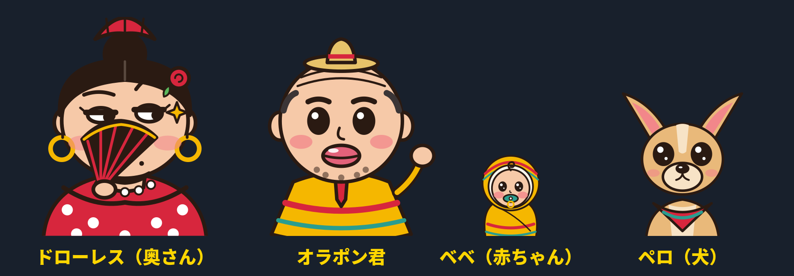

# オラポン君 キャラクター設定シート

別のセッションで動画を作るときに、この1枚を読めば同じキャラクターを再現できるようにまとめたもの。
（2026-11-19 時点。見た目はキャラデザイン担当の別セッションが作った「清書前のラフ」）

## 基本
| 項目 | 内容 |
|---|---|
| 名前 | オラポン君 |
| 何者か | スペイン語を教える、キモ可愛いおじさん |
| デザイン | 案1「ハポン・ソンブレロおじ」（小さなソンブレロ、黄色いポンチョ、赤い蝶ネクタイ風、うっすらヒゲ） |
| 出ている所 | ショート動画「こんな時スペイン語でなんて言う？」（チャンネル「スペイン語 会話のへや」） |

## 家族

- 奥さん：ドローレス（意地悪。`../dolores/CHARACTER.md`）
- 赤ちゃん：ベベ（生まれたばかり。ポンチョ柄のおくるみ、いつもおしゃぶり。`../bebe/CHARACTER.md`）
- 犬：ペロ（臆病なチワワ。`../pero/CHARACTER.md`）
- 車：`../car/`（ソンブレロをかぶった黄色いコミカルな車。走る・故障の2種類）
- 家と庭の背景：`../scenes/`（スペイン・メキシコ風の家、表札「Casa de Olapón」、ペロの犬小屋）
- 使い方の例：オラポン君が直訳で間違える → ドローレスが扇子で「オホホ」、ペロがぶるぶる。正解すると → ペロとベベが大喜び、ドローレスはつまらなそうなジト目

## 口調
- 語尾は「ポン」。ただし**多すぎると不評**（1本で7回は多すぎた）。**1本あたり3〜4回**が目安
  - オラ〜ポン！（あいさつ・口ぐせ）／ 〜と思うポン？ ／ 正解の「ポン！」／ 〜覚えるポン！
- 正解のとき「ポン！」、不正解のとき「ポ〜ン…」（ただし不正解の声は、ポンが多くなるので今は使わず表情だけ）
- 口ぐせは「¡Hola〜ポン!」。合成音声に読ませるときは「オラ〜ポン！」とカタカナで書く
- 日本語の声にスペイン語を読ませない（発音が崩れる）。スペイン語の部分は「画面の言い方」などと言い換える
- 秋田弁も試した（下の「声」参照）。「オラ」は東北の方言で「私」なので相性が良い

## 表情の使い分け（ショート動画）
| 場面 | 表情 |
|---|---|
| お題を出す | 口パク用の顔（手を振っている）で話す |
| 直訳すると…（間違い） | しょんぼり |
| 自然な言い方（正解） | 決め顔（流し目＋バラ）で「ポン！」 |
| 使ってみよう（会話） | 通常 |
| ひとことメモ | 口パクで話して、最後はドヤ顔 |
| （未使用） | 涙目・驚き |

## 素材（このフォルダ）
- `expressions/` … 表情6種（SVG、背景透過）
- `lipsync/` … 口のない顔 `base_nomouth.svg` ＋ 口の形 `mouth_a/i/u/e/o/n.svg`（重ねると位置がそろう）
- 全ファイル viewBox 共通 "30 28 240 236"、書き出しサイズ 960x944
- 色：肌 #F6C9A8 / 唇 #E2627A / 口の中 #9E2B3A / ポンチョ #F5B700 / 赤 #D7263D / 青緑 #2A9D8F / ソンブレロ #E7C36A / 線 #2A1A12
- 元データ（キャラデザインのセッションの Artifact）：https://claude.ai/artifact/AchhuEwePXS21WB8tyzYX4
  - デザイン案5種：https://claude.ai/artifact/4qhRLbwTkdh4p6rY9E4La4
  - 表情差分：https://claude.ai/artifact/QnaDpdZf2cj1CPc51SFypi
  - サムネ案3種：https://claude.ai/artifact/SYn3Xi3Ap4VVxuZJhEg3KC

## 口パクのしかた
- `scripts/character.py` の `mouth_track()`：声の大きさから1コマ（1/15秒）ごとに口の形を決める
  - 大きい→あ、中くらい→お・え（交互）、小さい→い・う（交互）、無音→閉じる（n）。最後は必ず閉じる
- 素材の目安は「30fpsで1枚2〜4フレーム」。あ段→a、い段→i …、ん・無音・ま/ば/ぱ行→n
- 画面への重ね方・表情の切り替えは `scripts/build_short.py`（`with_character()`・`add_talking()`）

## 声（まだ決まっていない）
いま動画に使っている設定と、試した候補。**ユーザーは見本の声を用意して考え直す予定**。

| 項目 | 内容 |
|---|---|
| 音声合成 | Kokoro（Apache-2.0、商用利用可）。`scripts/say_ja.py`。Python 3.12 の別環境が必要（README 参照） |
| 今の設定 | 女性の声 `jf_alpha` を2半音下げ、声の響き（フォルマント）も下げて「高い声のおじさん」（約242〜258Hz） |
| 高さを変える方法 | ffmpeg の `rubberband` フィルター（`formant=shifted`）。asetrate で変えると機械っぽくなる |
| もう少し低い候補 | 3半音下げ（約232Hz）、4半音下げ（約219Hz） |
| しゃがれ声 | `scripts/hoarse.py`（強さ1〜3：しゃがれ弱・中・強、4〜5：つぶれた声 中・強） |
| ボツになった声 | 男性の声 `jm_kumo` を下げたおじさん声（若すぎ→低すぎ）、男性の声を7半音上げた声（機械的すぎ） |
| 使えない声 | Piper の日本語 `hi_fi_captain`（非商用ライセンス）、VOICEVOX（この環境から入手できない） |

聞き比べ（`voice_samples/`）：
- `声の聞き比べ_前回_B_C_D.m4a` … 機械的だった声 → 男性を自然に上げた声 → 今の設定 → 少し低い版
- `秋田弁_声のサンプル_3段階低_4段階低.m4a` … 秋田弁のセリフ、3半音下げ → 4半音下げ
- `しゃがれ声_弱_中_強.m4a` … 3半音下げ＋しゃがれ 1・2・3
- `つぶれた声_しゃがれ強_つぶれ中_つぶれ強.m4a` … しゃがれ3 → つぶれ4 → つぶれ5

## 秋田弁のセリフの例（ショート#01）
- 最初：「オラ〜ポン！『それな』って、スペイン語で、なんて言うと思うべ？」
- 最後：「これはな、スペインでよぐ使う言い方だべ。中南米だば、画面の2つ目の言い方が安心だす。フォローしてけれ、毎日1フレーズ覚えるポン！」
- 注意：アクセントは標準語のまま（合成音声の限界）。方言の自然さは秋田弁の話者に確認が必要

## 注意
- 実在の人（芸能人など）の声をまねて作らない。見本の声は「高さ・速さ・声質を参考にする」まで
- 合成音声を使うので、YouTube のアップロード時に「改変または合成されたコンテンツ」は「はい」にする
