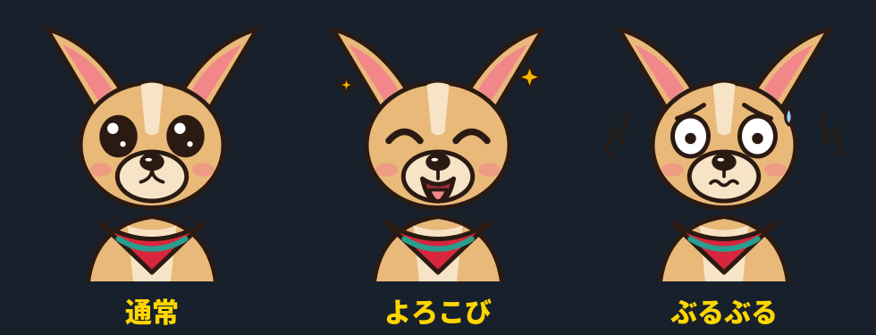

# ペロ（オラポン君の犬） キャラクター設定シート

| 項目 | 内容 |
|---|---|
| 名前 | ペロ（スペイン語の *perro*＝犬。名前そのものが単語の勉強になる） |
| 犬種 | チワワ（メキシコ原産。オラポン君のソンブレロの雰囲気に合わせた） |
| 見た目 | 大きな耳、うるうるの大きな目、オラポン君のポンチョと同じ赤と青緑のバンダナ |
| 性格（案） | 臆病でよく震えるが、オラポン君が正解すると誰よりも喜ぶ。奥さんのドローレスが怒るとぶるぶる震える |
| 鳴き声（案） | 「ワン」ではなくスペイン語の犬の鳴き声「 guau（グアウ）」。豆知識ネタになる |

## 表情（expressions/）
| ファイル | 表情 | 使う場面の例 |
|---|---|---|
| 01_normal | 通常（うるうるの目） | ふだん |
| 02_happy | よろこび（目を細めて舌を出す、キラキラ） | オラポン君が正解したとき |
| 03_buruburu | ぶるぶる（目を見開いて震える、汗） | ドローレスが怒ったとき、不正解のとき |

## 素材の決まり
- オラポン君と同じ：SVG・背景透過・viewBox "30 28 240 236"・書き出し 960x944・線 #2A1A12・太さ4
- 色：毛 #E9B97A / 明るい毛 #F7E3C6 / 耳の中 #F2878A / バンダナ #D7263D・#2A9D8F
- 口パク用の素材はまだない（しゃべらせる場合は作る）
- まだ清書前のラフ
