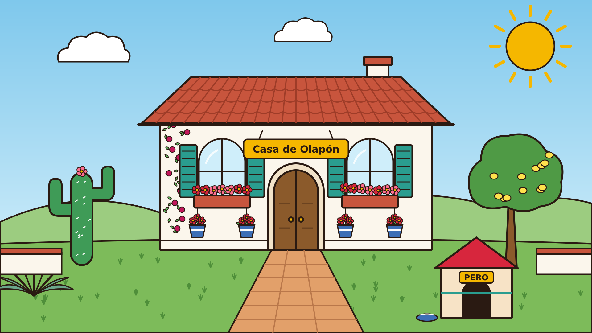

# 背景：オラポン一家の家と庭

| ファイル | 中身 |
|---|---|
| `house_garden.svg` / `.png` | 家と庭の背景（16:9、1920x1080） |
| `house_with_family.png` | 家の前に3人を並べた見本 |
| `make_house.py` | 背景を作るプログラム（色や配置を変えるときはここを直して `python3 characters/scenes/make_house.py`） |

## デザイン
- スペイン・メキシコ風の家：白い漆喰の壁、テラコッタの瓦屋根、アーチの木のドア、青緑のよろい戸
- 表札「Casa de Olapón」（スペイン語で「オラポンの家」。背景でも単語が覚えられる）
- アンダルシア風の青い植木鉢と赤いゼラニウム、窓の花のプランター、壁をはうブーゲンビリア
- 庭：サボテン（サワロ）、アガベ、レモンの木、タイルの小道、低い白い塀
- ペロの犬小屋（赤い屋根、「PERO」の名札、青い水入れ）
- キャラクターと同じ絵柄（濃い茶色の太い線 #2A1A12、同じ色の組み合わせ）
- まだ清書前のラフ。ショート用の縦長（9:16）版は未作成
